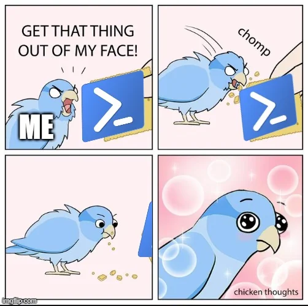
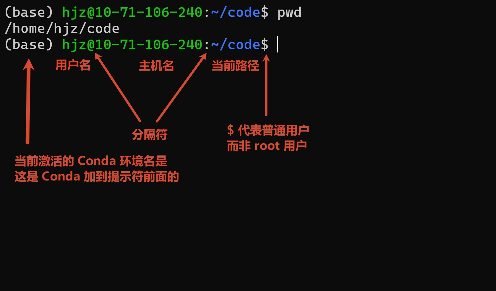

# 终端和 Shell 基础

!!! note
    本文整理自浙江大学竺可桢学院 2023 年秋冬学期“实用技能拾遗”第一讲《Shell 基础及 CLI 工具推荐》。原讲者：[@45gfg9](https://github.com/45gfg9)；系列课程项目：[@TonyCrane](https://github.com/TonyCrane)。参见[原版幻灯片](https://slides.tonycrane.cc/PracticalSkillsTutorial/2023-fall-ckc/lec1/#/)、[幻灯片 Markdown 源码](https://github.com/TonyCrane/PracticalSkillsTutorial/blob/master/slides/src/lec1.md)与[讲座回放 BV1ry4y1A7qo](https://www.bilibili.com/video/BV1ry4y1A7qo/)。

    

<!-- 在学习完本文后，进一步的内容还有：

- [包管理器](package-manager.md)
- [Vim](vim.md)
- [GNU Make](make.md) -->

## 为什么需要学习命令行

在图形化桌面中，我们习惯用鼠标双击文件、打开应用、复制和移动文件，这种交互方式称为**图形用户界面**（Graphical User Interface，GUI）。早期操作系统没有图形界面，与计算机交互主要依靠**命令行界面**（Command-Line Interface，CLI）：在**终端**（Terminal）中输入命令，让计算机执行操作并返回结果。例如下图中的 DEC VT100。

<div align="center">
  
  <p><em>VT100 图片来源：Gorthmog，CC BY-SA 4.0，<a href="https://commons.wikimedia.org/wiki/File:DEC_VT100_terminal_transparent.png">Wikimedia Commons</a>。</em></p>
</div>

即使是在现代计算机中，掌握命令行也十分有助于我们方便、高效地执行各种操作：

- 管理文件，包括搜索、移动、复制、编辑文件，以及从网络上下载文件；
- 编译程序；
- 处理文本，完成增删改查；
- 把经常重复的步骤组织成自动化流程；
- 通过 SSH 登录没有图形桌面的远程服务器。

作为一个 CS 人，终端可以说是我们日常必不可少的一部分。

如果你在[开发环境安装与第一次编译运行](../env/index.md)中选择了用 VS Code 编辑代码、用 GCC 编译代码，那么你应该已经体验过终端交互。假设当前目录中有一个 `a.c` 文件：

```c
#include <stdio.h>

int main(void) {
    puts("Hello world!");
}
```

在终端中可以查看源码、编译并运行：

```sh
cat a.c           # 显示文件内容
gcc a.c -o a      # 编译 a.c，生成可执行文件 a
./a               # 执行当前目录下的 a
# 输出：Hello world!
```

这里有三个命令：`cat` 查看源文件 `a.c` 的内容；`gcc` 将源文件编译为可执行文件；`./a` 运行得到的程序。

## Terminal 和 Shell 的区别

一言以蔽之：**Terminal（终端）**提供文字交互界面，而 **Shell** 负责解释命令。

Terminal 一词原有“终点”的含义。[Online Etymology Dictionary](https://www.etymonline.com/word/terminal) 记载，其“用于与计算机通信的设备”这一意义最早见于 1954 年。早期终端是连接计算机的实体设备，通常具有键盘和显示装置，可输入数据、运行程序并观察结果。

今天电脑里的终端通常指 **Terminal Emulator（终端模拟器）**：一个负责显示文本、处理键盘输入并管理交互界面的应用。它可以承载一个 Shell，让我们看到命令提示符和程序输出。

<div align="center">
  
</div>

现代操作系统中基本都自带了终端：

- Windows 11 用户可以使用微软提供的 *Windows Terminal*；Windows 10 可以在微软应用商店下载；
- Linux 桌面常见的选择有 *GNOME Terminal*、*Konsole*、*LXTerminal*；
- macOS 自带 *Terminal.app*，也可安装 *iTerm2*。

至于 Shell ，可以理解为用户与操作系统之间的一层命令解释界面。我们在终端中输入指令后，终端负责把输入交给 Shell；Shell 分析命令、查找要执行的程序，配合操作系统启动程序，随后终端显示它的输出。交互流程大概如下：

```text
用户输入 → Terminal（接收与显示） → Shell（解析命令）
                                      ↓
                              操作系统与被执行的程序
                                      ↓
用户看到结果 ← Terminal（显示输出） ← 程序的输出
```

常见 Shell 包括：

- Windows：`cmd.exe`、Windows PowerShell 5，以及新版跨平台的 PowerShell 7（`pwsh`）。
- Unix/Linux/macOS：`sh`（Bourne Shell）、`bash`（Bourne Again Shell）、`zsh`（Z Shell）、`fish`（Friendly Interactive Shell） 。
Bash 广泛应用于 Linux，Zsh 自 macOS Catalina 开始成为 macOS 默认交互 Shell。

!!! note
    大部分 Shell 的部分语法看起来相似，但并不完全相同。实际输入命令或编写脚本时，应当先确认自己正在使用哪一种 Shell。

!!! tip
    如果使用 Zsh，可以试试 [Oh My Zsh](https://ohmyz.sh)，这个工具为 Zsh 提供主题与插件配置框架，使自定义提示符和功能扩展更加方便。配置可以参考 [Tonycrane 的 Shell 笔记](https://note.tonycrane.cc/cs/tools/shell/)。
!!! tip
    如果你使用 PowerShell，建议将 Windows 自带的 Windows PowerShell 5 升级至 PowerShell 7，参见[安装指南](https://learn.microsoft.com/en-us/powershell/scripting/install/install-powershell-on-windows)。还可以搭配 [Oh My Posh](https://ohmyposh.dev/) 使用。

    微软官方为 PowerShell 提供了详细的[学习指导](https://learn.microsoft.com/en-us/powershell/scripting/learn/ps101/01-getting-started)和[文档](https://learn.microsoft.com/en-us/powershell/)。

    

## Shell 操作基础

这里以 Bash 为例进行介绍。Bash 免费、应用广泛，也是许多 Linux 系统的默认 Shell。

### 命令提示符与工作目录

打开终端并启动 Bash 后，通常会出现一行等待输入的文字，称为 Prompt（命令提示符）。它可能包含当前用户名、主机名、所在目录等信息。你可以输入命令，这些命令通常在按下回车后执行。

<div align="center">
  
</div>

对于初学者，最需要关注的是当前的目录，或者说工作目录（Working Directory），即当前 Shell 所处的位置。同一条相对路径命令，从不同目录执行，会作用于不同文件。

例如，在不清楚所在目录时输入 `rm -rf ./*`，可能删除当前目录下全部文件：`rm` 代表删除（remove）`-r` 表示递归，`-f` 表示强制，`./*` 指向当前目录中匹配到的项目。这个例子是危险操作，切勿复制执行 :-)。

<!-- 另一个需要关注的信息是当前用户身份：在 Linux 系统中普通用户与管理员 `root` 的权限不同。使用特权命令前，应该清楚操作对象和后果。 -->

输入 `pwd` 可以查询当前目录。

在 Linux/macOS 中，所有文件最终都组织在以 `/` 为根的目录树下。路径中的 `/` 是分隔符，个人主目录可以简写为 `~`。而 Windows 常见 `C:\`、`D:\` 等盘符，并通常使用反斜杠 `\` 分隔目录。由于路径系统不同，刚开始接触 Linux 的同学可能会问「为什么没有 C 盘」，其实文件树的组织方式不同而已。

### 路径、相对路径与绝对路径

`pwd` 的全名是 *print working directory*；`cd` 是 *change directory*，用于进入另一个目录。路径既可以从根目录 `/` 开始写成绝对路径，也可以从当前目录出发写成相对路径。下面是几个特殊的标记：

| 记号 | 含义 |
|---|---|
| `/` | 类 Unix 文件系统的根目录 |
| `~` | 当前用户主目录 |
| `.` | 当前目录 |
| `..` | 上一级目录 |

考虑两个例子。

例子 1：假设目前位于 `/home/hjz/`，希望进入 `/usr/bin/`：

```sh
cd /usr/bin          # 使用绝对路径
```

```sh
cd ../../usr/bin     # 从 /home/hjz/ 使用相对路径
```

两行是互相替代的两种写法。

例子 2：从 `/usr/` 进入 `/usr/games/`：

```sh
cd /usr/games        # 绝对路径
cd games             # 相对路径
cd ./games           # 相对路径，显式写出当前目录
```
这三行也是可以互相替代的不同写法。

`cd` 不带参数通常会返回个人目录。

### 文件与目录的创建、查看、复制和删除

Linux/Unix 系统通常使用 directory（目录）这一术语，相当于图形文件管理器中的 folder（文件夹） 。文件与目录操作主要涉及以下 bash 命令：

| 命令 | 用途与常用选项 |
|---|---|
| `ls` | 列出当前目录内容；`ls -a` 同时显示隐藏文件；`ls -l` 显示权限、大小、时间等详细信息；也可组合为 `ls -la` |
| `touch file` | 创建空文件；若文件已有内容，通常更新文件时间戳 |
| `mkdir dir` | 创建目录 |
| `cp src dst` | 复制文件；复制目录可用 `cp -r src dst` 递归进行 |
| `mv src dst` | 移动或重命名文件、目录 |
| `rm files` | 删除文件；`-r` 递归处理目录，`-f` 强制操作，慎用 |
| `find path -name 'pattern'` | 在指定路径下按名称模式搜索文件和目录 |

建议大家自己尝试一下下面的例子：

```sh
mkdir cli-practice              # 创建 cli-practice 子目录
cd cli-practice                 # 打开 cli-practice 目录
touch hello.txt                 # 创建 hello.txt 文件
ls -la                          # 列出当前目录的文件
cp hello.txt hello-copy.txt     # 把文件 hello.txt 复制一份 hello-copy.txt
mv hello-copy.txt backup.txt    # 重命名 hello-copy.txt 为 backup.txt
mkdir archive                   # 创建 archive 子目录
mv backup.txt archive/          # 把 backup.txt 放到 archive 子目录下
find . -name '*.txt'            # 查找 .txt 文件
```

`find` 的 `*.txt` 代表匹配任意以 .txt 结尾的文件，`*` 代表通配符。

!!! warning
    **不要轻易使用删除命令**。系统中的 `rm` 不会把文件先放进回收站，`rm` 删掉的文件就是真没了。

### 查看文件内容

阅读日志、源代码、配置文件，或者查看二进制文件的内容，可以使用下列命令：

| 命令 | 作用与选项 |
|---|---|
| `cat file1 file2 ...` | 将文件内容输出并依次拼接；`cat -n file` 显示行号 |
| `head file` | 输出前 10 行；`head -n N file` 指定显示前 N 行 |
| `tail file` | 输出后 10 行；`tail -n N file` 指定显示后 N 行 |
| `more file` | 分页浏览内容 |
| `less file` | 更灵活的分页浏览，可前后翻页、搜索等；详细选项用 `less --help` 查询 |
| `hexdump file` | 按十六进制方式查看字节；`-C` 并排显示十六进制与 ASCII；`-n N` 只取前 N 字节 |

在 `more` / `less` 进入浏览内容时，还可以进一步操作：空格通常表示向下翻页，回车向下一行，`q` 退出；`less` 还可以用 `/关键词` 搜索。

对于很大的文件，用 `tail` 或 `head` 指令往往比一次性 `cat` 整个文件更好读。

### 其他基础命令

以下命令在日常使用中也很常见：

| 命令 | 基本用途 |
|---|---|
| `man` | 查阅命令手册（manual），例如 `man cat` |
| `echo` | 输出文本与变量值，经常与重定向、管道一起使用 |
| `whoami` | 显示当前用户 |
| `whereis`、`which`、`whence` | 查找命令及其位置；具体可用性依 Shell 和系统而定 |
| `clear` | 清空终端当前显示内容 |
| `chmod` | 修改文件访问权限 |
| `ps` | 查看进程信息 |
| `date` | 显示日期与时间 |
| `kill` | 向进程发送信号，可用于请求进程终止 |
| `grep` | 搜索文本中匹配指定模式的行 |
| `diff` | 比较文件或目录之间的差异 |
| `curl` | 发送网络请求，例如 HTTP 请求 |
| `wget` | 下载网络资源 |

这些命令有各种参数，初学时不必全部背下来。例如，如果想了解 `ls` 的参数，可以运行 `man ls`：

<div align="center">
  
</div>

### 重定向和管道

Shell 的一个强大之处是能够把不同程序连接起来。这里有三个常用的数据通道：

| 名称 | 简写 | 文件描述符 | 含义 |
|---|---|---|---|
| 标准输入 | `stdin` | `0` | 程序从哪里接收输入 |
| 标准输出 | `stdout` | `1` | 程序正常执行时输出内容到哪里 |
| 标准错误 | `stderr` | `2` | 程序把错误或诊断信息输出到哪里 |

在终端中，程序通常从键盘相关的输入端读取内容，将输出和错误显示在屏幕上。**重定向（redirection）**允许我们改变这些默认去向，例如把输出写入文件，或者让程序从文件读取输入。

bash 常见的重定向操作符如下：

| 写法 | 含义 |
|---|---|
| `command > file` | 将标准输出写入文件；文件已有内容时通常覆盖 |
| `command >> file` | 将标准输出**追加**到文件末尾 |
| `command < file` | 让程序从指定文件读取标准输入 |
| `command 2> file` | 将标准错误写入文件，`2` 即 stderr 的描述符 |
| `command &> file` | 在 Bash/Zsh 中将标准输出和标准错误同时写入文件 |

示例：

```sh
echo "Hello world" > message.txt     # 写入字符串
cat first.txt second.txt > all.txt   # 拼接两个文件
diff old.txt new.txt > changes.txt   # 保存差异
./a.out < input.txt                  # 由文件提供程序输入
ls nonexistent 2> errors.txt         # 保存错误信息
echo "another line" >> message.txt   # 追加而不覆盖
```

**管道**（pipe）通过 `|` 连接命令：左边命令的标准输出成为右边命令的标准输入。

例子 1：

```sh
cat access.log | grep 'ERROR' | tail -n 10
```

第一步输出日志；第二步筛选包含 `ERROR` 的行；第三步只保留最后十行。

例子 2：下面是一个稍复杂的例子：

```sh
cat /home/admin/access.log | cut -d ' ' -f 1 | sort | uniq -c | sort -nr | head -n 1
```

这条命令中，`cat` 输出日志；`cut -d ' ' -f 1` 以单个空格为分隔符，取每一行的第一个字段；`sort` 按照字典序排列文本，让相同文本相邻；`uniq -c` 统计重复次数；`sort -nr` 按数值降序排列；最后，`head -n 1` 取出计数最大的一行。

!!! note
    管道符 `|` 将前一个命令的标准输出作为输入流，传给后一个命令的**标准输入**，而不是作为后一个命令的**参数**。

    例如，`ls | cat` 不能实现“输出当前目录中每个文件的内容”，它本质上等同于：

    

    正确的操作是 ``cat `ls` `` 或者 `ls | xargs cat`。

除了 `cat`、`grep`、`head`、`tail`，适合处理文本流的工具还有 `cut`、`sort`、`uniq`、`awk` 等等，不再赘述。

遇到看不懂的长命令，可将其贴到 [explainshell](https://explainshell.com)，逐段了解每个操作符和参数的用途。

## 环境变量、PATH 与配置文件

在 Linux 中，很多 Shell 命令最终会启动一个可执行文件。比如 `ls` 通常对应系统中某个位置的可执行程序，如 `/bin/ls` 或 `/usr/bin/ls`。可我们在终端里只输入 `ls` 就可以运行，为什么不需要先定位它的完整路径竟能运行？

关键在于 **环境变量（environment variable）**，尤其是 `PATH`。环境变量是传递给程序的一组带名字的值，常用于描述系统环境、用户配置、搜索路径等信息。`PATH` 记录 Shell 搜索可执行程序时应当检查的目录列表。在 bash 中可以用下面的命令查看：

```bash
echo "$PATH"  # 查看 PATH 的值
env           # 查看当前环境变量集合
```

Shell 通过 `PATH` 搜索 `ls` 时，会在路径列表中寻找匹配的可执行程序。这个机制也解释了为什么本地编译产生的 `a.out` 需要写成 `./a.out`：`.` 表示当前目录，而当前目录一般不在、也不应该随意添加到 `PATH`。

Windows 系统的原理相同。在 PowerShell 中，可以用下面的命令查看环境变量：

```powershell
echo $env:PATH  # 查看 PATH 的值
ls Env:         # 查看当前环境变量集合
```

在 Bash（以及 Zsh 等 Shell）中，可以用 `export` 让变量进入后续启动的子进程环境；`unset` 则删除该变量。这样的修改不会永久保存，关闭 Shell 后重新打开一个独立会话，会恢复默认设置。

```bash
export GREETING="Hello"
echo "$GREETING"
unset GREETING
echo "$GREETING"  # 此时通常为空
```

Bash 可以在启动时读取配置文件，自动设置环境变量、别名、提示符等内容，个人配置一般位于 `~/.bashrc`。例如，需要设置一个长期使用的变量时，可以在这个文件中增加一行：

```bash
export EDITOR=vim
```

保存配置文件后重新打开 Shell，相关设置会在新会话中加载。如果希望当前会话立刻执行一个配置文件，可以运行：

```bash
source ~/.bashrc
```

`source file` 的作用是在当前 Shell 中执行指定文件里的命令。

在 Windows 系统中，可以通过在 PowerShell 中输入 `echo $PROFILE` 来定位配置文件。


最后还要说的是：Shell 还是一门可以编程的语言。当命令已经能够独立完成一个操作时，就可以进一步考虑：**如何获取命令的返回值？怎样编写条件判断、循环、嵌套命令和函数？** 这些都属于 Shell 脚本编程的内容。它们能够把日常使用的一系列命令变成可重复执行的程序。

推荐继续阅读：

- [MIT The Missing Semester：Shell Tools and Scripting](https://missing.csail.mit.edu/2020/shell-tools/)
- [Shell 教程 - 菜鸟教程](https://www.runoob.com/linux/linux-shell.html)
+ 一些书：
    - Blum, R. (2008). *Linux command line and shell scripting bible*. John Wiley & Sons.
    - Robbins, A., & Beebe, N. H. (2005). *Classic Shell Scripting: Hidden Commands that Unlock the Power of Unix*.  O'Reilly Media, Inc..
    - Daniel J. Barrett (2022). Efficient Linux at the Command Line. O'Reilly Media, Inc.


## 值得尝试的 CLI 工具

熟悉 `ls`、`cat`、`grep`、`find` 以后，我们可能会希望获得更清晰的显示、更快捷的检索或更方便的目录跳转。对于编程、音视频和图像处理等复杂任务，我们也希望能有一些趁手的 CLI 工具。

开源社区围绕这些需求开发了不少工具，下面便是其中的一些代表，不一而足：

- **[bat](https://github.com/sharkdp/bat)** 是增强版的 `cat`，能为代码添加语法高亮、行号和文件名。
- **[fd](https://github.com/sharkdp/fd)** 是一个更易用的文件搜索工具，可作为 `find` 的补充。
- **[eza](https://github.com/eza-community/eza)** 为 `ls` 提供更丰富的目录列表显示。
- **[ripgrep](https://github.com/BurntSushi/ripgrep)** 是一个高性能文本搜索工具，常用命令为 `rg`。例如，`rg "TODO" .` 会在当前项目中查找包含 `TODO` 的文本。
- **[hexyl](https://github.com/sharkdp/hexyl)** 是一个十六进制查看器，作用与 `hexdump` 相近，但显示更直观。
- **[btop](https://github.com/aristocratos/btop)** 是一个命令行资源监控工具，可以显示 CPU、内存、磁盘、网络与进程状态。
- **[neofetch](https://github.com/dylanaraps/neofetch)** 在终端中显示系统的 ASCII 图案，并列出操作系统、内核版本、开机时间等信息。该项目目前已停止活跃维护，选择同类工具时可以留意后续替代项目。
- **[cling](https://github.com/root-project/cling)** 为 C++ 提供交互式解释执行环境，使用感受类似 Python 的 REPL，适合快速试验小段 C++ 代码。
- **[FFmpeg](https://github.com/FFmpeg/FFmpeg)** 提供强大的音频、视频与字幕处理功能，常用于格式转换、编解码、剪辑与批处理。
- **[ImageMagick](https://github.com/ImageMagick/ImageMagick)** 是一个图片处理工具，可以转换格式、调整尺寸、裁剪和编辑图片。例如，把 JPG 转成 PNG 只需一行命令，非常方便：

    ```sh
    magick input.jpg output.png
    ```

- **[tldr](https://github.com/tldr-pages/tldr)** 可以视作 `man` 的实用补充。`man` 通常给出完整手册，`tldr` 则提供简明说明与典型用例。
