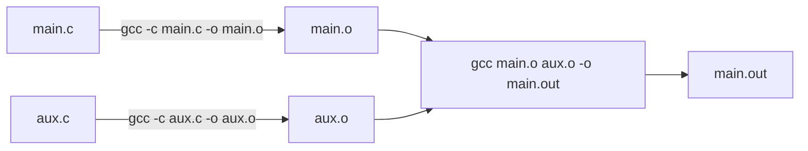

# GNU Make

我们可以用 `gcc a.c -o a` 编译一个 C 程序。假如项目中只有 `a.c` 一个文件，手动执行命令确实很方便；但如果有多个 `.c` 和 `.h` 文件，输入命令会逐渐变得繁琐。

[GNU Make](https://www.gnu.org/software/make) 是一个自动化构建工具，类似工具还有 [CMake](https://cmake.org/) 和 [XMake](https://xmake.io/) 等。我们在名为 **Makefile** 的文件中描述“怎样产生目标程序”“目标依赖哪些文件”“需要运行什么命令”，随后用 `make` 命令执行构建。

Linux 内核等大型项目长期使用 Make 构建系统。Make 也可以组织测试、生成文档、打包、部署等任务；只要任务能够通过命令完成，就可能适合写进 Makefile。有文件间的依赖关系时，Make 通常比一串简单的 Shell 命令更方便、更容易维护。

<div align="center">
  
</div>

## Makefile 的规则

Makefile 最基本的规则结构为：

```make
目标: 依赖项1 依赖项2 ...
	需要执行的命令
	另一条命令
```

三部分分别叫 target（目标）、prerequisites（先决条件或依赖项）、recipe（命令）。当需要生成目标，而且它不存在或它所依赖的文件发生改变时，Make 会决定执行哪些构建步骤。

!!! note
    recipe 命令行必须以 Tab 字符开头，不能用空格代替。

### 伪目标

Makefile 支持**伪目标**（phony target）。例如，`clean` 往往只是一个“清理构建文件”的操作名称，并不代表要生成名为 `clean` 的文件：

```make
.PHONY: clean

clean:
	rm -f main.o aux.o main.out
```

命令行还可以添加前缀：以 `@` 开头时，执行前不把命令本身打印到终端；以 `-` 开头时，即使当前命令失败，也不立即因此停止构建。

## 变量

Makefile 可以定义变量，减少重复输入。它与 Shell 变量的语法和求值方式有所不同，常见赋值方式有四种：

| 语法 | 解释 |
|---|---|
| `VAR = value` | 递归展开变量，通常在引用时展开右侧内容 |
| `VAR := value` | 简单展开变量，赋值时立即展开右侧内容 |
| `VAR ?= value` | 仅当变量未被定义时设为该值 |
| `VAR += value` | 将内容追加到变量已有的值之后 |

引用变量时可写 `$(VAR)` 或 `${VAR}`。Make 会把这些引用展开为相应内容，可简单理解为一种文本替换机制。还可以通过 `$(shell command)` 获得 Shell 命令的输出并用于变量展开。Make 自带一些有用的变量，比如用于递归调用 Make 的 `$(MAKE)`，也可以获取环境中的 `$(PATH)`。

## 一个例子

假设目录中有 `main.c` 和 `aux.c`，我们希望把它们分别编译为 `.o` 文件，再链接得到可执行程序 `main.out`。

!!! note
    `.o` 指的是是目标文件，由单个 .c 文件编译得到，但还不是完整程序。例如 `main.c` 调用了 `aux.c` 里的函数时，`main.o` 里只有“我要调用这个函数”的记录，而这个函数本身还没有确定。`aux.o` 里才有该函数的实现。链接器负责把两者合起来，解析这些引用。

    一个项目通常有多个源文件，如果只修改其中一个，就对所有源文件重新执行编译、链接步骤，就太浪费时间了。因此，多一个“生成中间文件”的步骤，可以让我们在只修改其中一个源文件时，就无需再重新编译其它文件。例如，如果我们修改了 `aux.c`而没改 `main.c`，只需要再生成 `aux.o` ，将之与已经有的 `main.o` 重新合起来就行了，不用再编译 `main.o`。



我们编写出下面的 Makefile：

```make
CFLAGS = -std=c99

main.out: main.o aux.o
	gcc $^ -o $@ $(CFLAGS)

%.o: %.c
	gcc -c $< -o $@ $(CFLAGS)
```

它包含一项变量定义和两条规则：

- 变量 `CFLAGS` 的值是 `-std=c99`；
- 第一条规则说明，产生 `main.out` 依赖 `main.o` 和 `aux.o`，需要调用 GCC 把两个目标文件链接起来；
- 第二条规则 `%.o: %.c` 是“模式规则”，表示从对应的 `.c` 文件生成 `.o` 文件，例如 `main.c → main.o`、`aux.c → aux.o`。

其中有三个常用的**自动变量**：

| 写法 | 在这份 Makefile 中的含义 |
|---|---|
| `$@` | 当前规则的目标 |
| `$^` | 当前规则的全部依赖项 |
| `$<` | 当前规则的第一个依赖项 |

以第一条规则为例，`gcc $^ -o $@ $(CFLAGS)` 展开后类似于：

```bash
gcc main.o aux.o -o main.out -std=c99
```

第二条规则生成 `main.o` 时，相当于执行：

```bash
gcc -c main.c -o main.o -std=c99
```

修改某个源文件后再次执行 `make`，Make 会根据文件依赖与时间戳判断需要重新构建哪些目标。对于文件较多的项目，这比手动反复拼接 GCC 命令更容易管理。

## 运行 Make

直接执行 `make` 时，通常会使用 Makefile 的第一个目标作为默认目标；也可以明确写出希望执行的一个或多个目标：

```sh
make
make main.out
make a.o b.o c.o
make clean
```

还可以在命令行覆盖变量的值：

```sh
make a.o CFLAGS="-std=c11 -Wall"
```

一般情况下，变量值的优先关系是“命令行指定 > Makefile 中定义 > 环境变量”。GNU Make 还支持 `override` 和 `-e` 等影响优先级的机制。日常使用中，命令行赋值最适合临时切换编译选项。

## 常用命令行选项

| 命令 | 功能 |
|---|---|
| `make -f FILE` | 明确指定要使用的 Makefile 文件名 |
| `make -n` | 只打印将运行的命令，不实际执行，称为 dry-run |
| `make -j N` | 最多并行运行 N 个构建任务，常用于加速编译 |
| `make -k` | 某个目标出错后，尽量继续构建其他不依赖该错误结果的目标 |

## 参考阅读

- [《和我一起写 Makefile》](https://seisman.github.io/how-to-write-makefile/)
- [GNU Make 官方手册](https://www.gnu.org/software/make/manual/make.html)
- [写给初学者的Makefile入门指南 - 吉平.集的文章 - 知乎](https://zhuanlan.zhihu.com/p/618350718)
